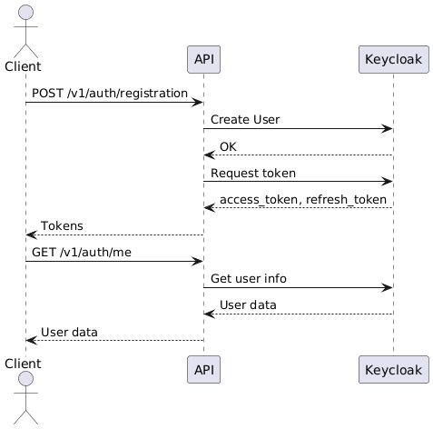
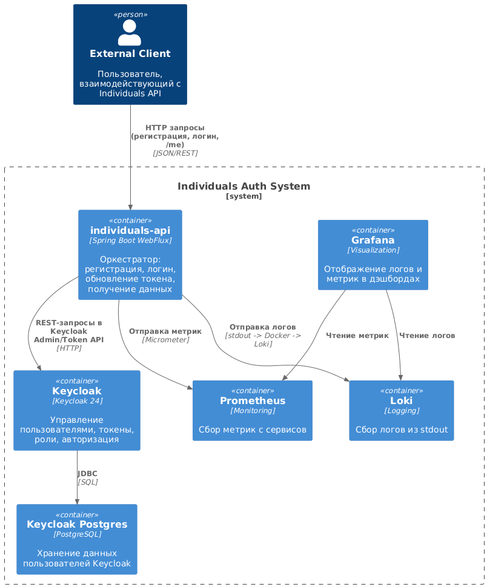
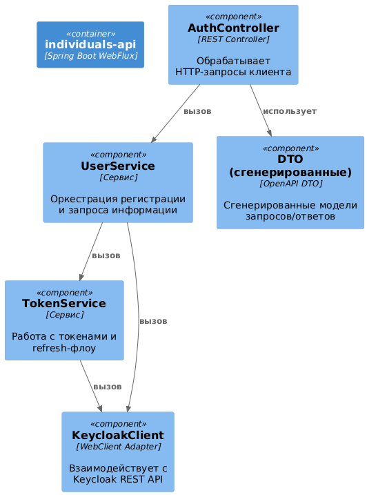

# Payment System (Individuals API)

Репозиторий микросервиса: 'individuals-api'.
Микросервис представляет из себя оркестратор авторизации через Keycloak и предоставляет API для:
- регистрации
- логина
- token refresh
- получение инфо о текущем пользователе.

## Stack

- Java 21+
- Spring Boot 3.5.x (WebFlux, Security, Actuator)
- Keycloak + PostgreSQL
- Prometheus
- Loki
- Grafana
- Docker Compose

## Структура

```text
payment-system/
  docker-compose.yaml
  individuals-api/
    Dockerfile
    openapi/individuals-api.yaml
    src/main/resources/
      application.yaml
      application-docker.yaml
      logback-spring.xml
      realm-config.json
  prometheus/prometheus.yml
  loki/loki-config.yaml
  grafana/
    provisioning/
      datasources/loki.yaml
      dashboards/dashboards.yaml
    dashboards/individuals-observability.json
```

## Архитектура
### API диаграмма


### Container


### Component


## API

- Эндпоинты аутентификации:
  - `POST /v1/auth/registration`
  - `POST /v1/auth/login`
  - `POST /v1/auth/refresh-token`
  - `GET /v1/auth/me`
- Генерация DTO через OpenAPI (`openapi-generator`)
- Prometheus метрики через Actuator (`/actuator/prometheus`)
- Сбор логов и отправка в Loki
- Grafana datasource provisioning (Prometheus + Loki)
- Grafana dashboard provisioning (`Individuals API Observability`)

## Требования к развёртыванию

- Наличие Docker
- Свободные порты: `3000`, `3100`, `5433`, `8080`, `8081`, `9090`

## Запуск

Из корня репозитория:

```bash
docker compose up -d --build
```

Проверка статуса:

```bash
docker compose ps
```

Ожидается, что все сервисы будут в состоянии `Up (healthy)`:

- `individuals-keycloak`
- `keycloak-postgres`
- `individuals-api`
- `prometheus`
- `loki`
- `grafana`

## URL для доступа к компонентам

- Individuals API: `http://localhost:8081`
- Keycloak: `http://localhost:8080`
- Prometheus: `http://localhost:9090`
- Loki readiness: `http://localhost:3100/ready`
- Grafana: `http://localhost:3000` (`admin` / `admin`)

## Curl API (заполните своими данными)

### 1. Registration

```bash
curl -X POST http://localhost:8081/v1/auth/registration \
  -H "Content-Type: application/json" \
  -d '{"email":"user1@example.com","password":"Password123!","confirm_password":"Password123!"}'
```

### 2. Login

```bash
curl -X POST http://localhost:8081/v1/auth/login \
  -H "Content-Type: application/json" \
  -d '{"email":"user1@example.com","password":"Password123!"}'
```

### 3. Refresh token

```bash
curl -X POST http://localhost:8081/v1/auth/refresh-token \
  -H "Content-Type: application/json" \
  -d '{"refresh_token":"<PASTE_REFRESH_TOKEN_HERE>"}'
```

### 4. Current user

```bash
curl http://localhost:8081/v1/auth/me \
  -H "Authorization: Bearer <PASTE_ACCESS_TOKEN_HERE>"
```

## Просмотр метрик

### Prometheus

Открыть `http://localhost:9090/targets`.

Target `individuals-api` должно быть `UP`.

Примерные запросы:

- `up{job="individuals-api"}`
- `rate(http_server_requests_seconds_count[1m])`
- `histogram_quantile(0.95, sum(rate(http_server_requests_seconds_bucket[5m])) by (le))`

### Loki

-> Grafana Explore -> datasource `Loki`:

- `{app="individuals-api"}`
- `{app="individuals-api", level=~"ERROR|WARN"}`

### Grafana Dashboard

Открыть Grafana (`http://localhost:3000`) и найти папку `Individuals API`.

Dashboard: `Individuals API Observability`

Уже включены следующие метрики:

- Requests Per Second
- HTTP Latency p95
- Error Rate (4xx/5xx)
- Latency percentiles (p50/p95/p99)
- WARN/ERROR logs panel

## Полезные команды

Перезагрузить проект:

```bash
docker compose down
docker compose up -d --build
```

Посмотреть логи контейнеров:

```bash
docker compose logs -f individuals-api
docker compose logs -f keycloak
docker compose logs -f grafana
```

Перезагрузить только Grafana (чтобы перезапустить provisioning):

```bash
docker compose restart grafana
```

## Чтобы отключить проект (все контейнеры)

```bash
docker compose down
```

## Transaction Service

Transaction Service доступен на `http://localhost:8084/api/v1`, Swagger UI - на
`http://localhost:8084/api/v1/swagger-ui.html`, метрики - на
`http://localhost:8084/api/v1/actuator/prometheus`.

Сервис поддерживает создание и чтение кошельков, а также `init`, `confirm`,
получение статуса и поиск транзакций. `init` выполняет только расчёт условий.
Запись транзакции и изменение баланса начинаются исключительно на `confirm`.
Deposit и withdrawal финализируются сообщениями Kafka; transfer завершается
синхронно в одной транзакции с пессимистической блокировкой кошельков.

Docker Compose запускает два PostgreSQL-шарда (`5435`, `5436`), Kafka
(`29092`) и Transaction Service. Профиль `sharding` использует конфигурацию
Apache ShardingSphere JDBC из `transaction-service/src/main/resources/sharding.yaml`.

Ключевые решения:

- `wallets`, `transactions` и `outbox_events` шардируются по `user_uid` (INLINE-алгоритм в `sharding.yaml`),
  `wallet_types` - broadcast-таблица. Схема на шардах создаётся init-скриптами PostgreSQL
  из `migration/V1__init_transactions_schema.sql` и `migration/V2__outbox_events.sql`
  (Flyway в профиле `sharding` выключен).
- Перевод между пользователями может затрагивать два шарда, поэтому включены XA-транзакции
  ShardingSphere (Atomikos); на PostgreSQL для этого задан `max_prepared_transactions`.
- События `DepositRequested`/`WithdrawalRequested` сохраняются в таблицу `outbox_events` в той же
  транзакции, что и операция (transactional outbox). `OutboxRelay` отправляет их в Kafka и помечает
  `SENT` только после подтверждения брокера; при ошибке событие отправляется повторно с нарастающей
  паузой, в том числе после перезапуска сервиса. Доставка at-least-once: получатель отсекает дубли
  по ключу сообщения (`transactionId`).
- Повторная доставка `DepositCompleted`/`Withdrawal*` не меняет уже финализированную транзакцию.
- Ответ провайдера не теряется: временные ошибки БД повторяются до успеха, невалидные сообщения
  и сообщения, для которых исчерпаны попытки, попадают в `<topic>.DLT`. Переотправить их в исходные
  топики: `curl -X POST localhost:8084/api/v1/actuator/dltreplay`.
- Платёжный провайдер - внешняя система: сервис публикует `deposit-requested`/`withdrawal-requested`
  и ждёт ответ в `deposit-completed`, `withdrawal-completed` или `withdrawal-failed`.

### Пример (напрямую в Transaction Service)

Ответ провайдера отправляется вручную.

```bash
USER=11111111-1111-1111-1111-111111111111
# 1. Кошелёк
curl -s -X POST localhost:8084/api/v1/wallets -H 'Content-Type: application/json' \
  -d '{"userUid":"'$USER'","walletTypeUid":"00000000-0000-0000-0000-000000000001","name":"main"}'
WALLET=<uid из ответа>
# 2. Расчёт условий пополнения (без записи в БД)
curl -s -X POST localhost:8084/api/v1/transactions/deposit/init -H 'Content-Type: application/json' \
  -d '{"userUid":"'$USER'","walletUid":"'$WALLET'","amount":100,"currency":"USD","paymentMethodId":1}'
# 3. Подтверждение: транзакция создаётся в статусе PENDING, в Kafka уходит DepositRequested
curl -s -X POST localhost:8084/api/v1/transactions/deposit/confirm -H 'Content-Type: application/json' \
  -d '{"userUid":"'$USER'","walletUid":"'$WALLET'","amount":100,"currency":"USD","paymentMethodId":1}'
TX=<transactionId из ответа>
docker exec payment-kafka /opt/kafka/bin/kafka-console-consumer.sh \
  --bootstrap-server localhost:9092 --topic deposit-requested --from-beginning --timeout-ms 5000
# 4. Ответ провайдера (вручную)
echo '{"transactionId":"'$TX'","status":"COMPLETED","amount":100}' | docker exec -i payment-kafka \
  /opt/kafka/bin/kafka-console-producer.sh --bootstrap-server localhost:9092 --topic deposit-completed
# 5. Статус COMPLETED, баланс 100.00
curl -s localhost:8084/api/v1/transactions/$TX/status
curl -s localhost:8084/api/v1/wallets/$WALLET
```

Для вывода ответ провайдера отправляется в `withdrawal-completed` или в `withdrawal-failed`
(`{"transactionId":"...","failureReason":"INSUFFICIENT_FUNDS_EXTERNAL"}`); при `withdrawal-failed`
сумма и комиссия возвращаются на кошелёк.

На Windows перед `docker exec` с путями внутри контейнера нужно выполнить
`export MSYS_NO_PATHCONV=1`.

Через Individuals API (`http://localhost:8081/v1/...`) доступны те же операции с
Bearer-токеном Keycloak; `userUid` в запросе должен совпадать с `sub` токена, иначе ответ `403`.

```bash
TOKEN=$(curl -s -X POST localhost:8081/v1/auth/login -H 'Content-Type: application/json' \
  -d '{"email":"user11@example.com","password":"password"}' | jq -r .access_token)
USER=$(curl -s localhost:8081/v1/auth/me -H "Authorization: Bearer $TOKEN" | jq -r .id)
curl -s -X POST localhost:8081/v1/wallets -H "Authorization: Bearer $TOKEN" \
  -H 'Content-Type: application/json' \
  -d '{"userUid":"'$USER'","walletTypeUid":"00000000-0000-0000-0000-000000000001","name":"main"}'
```

Трасса `individuals-api -> transaction-service -> Kafka` видна в Grafana (Explore -> Tempo),
логи - в Loki (`{app="transaction-service"}`).

Предустановленные типы кошельков:

- USD: `00000000-0000-0000-0000-000000000001`
- EUR: `00000000-0000-0000-0000-000000000002`

Архитектурные и sequence-диаграммы находятся в
`docs/transaction-architecture.md`.

Тесты Transaction Service:

```bash
cd transaction-service
./gradlew test
```

Feign-клиент для оркестратора генерируется из того же контракта при сборке individuals-api
(задача `generateTransactionClient`).

## Запуск тестов

Из individuals-api запустить:

```bash
./gradlew test
```
