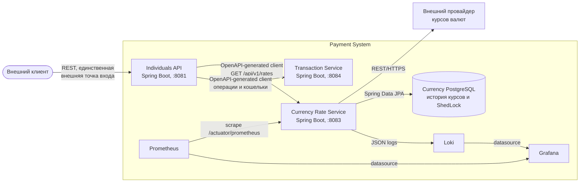
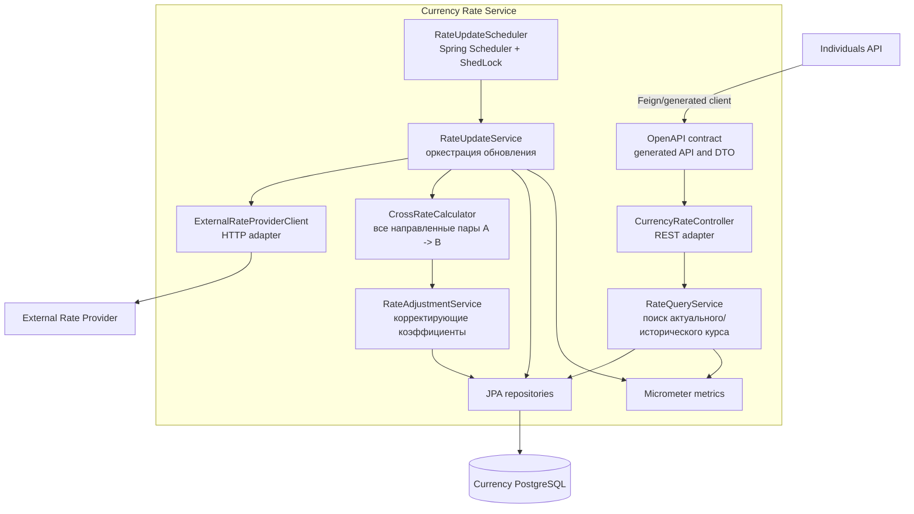
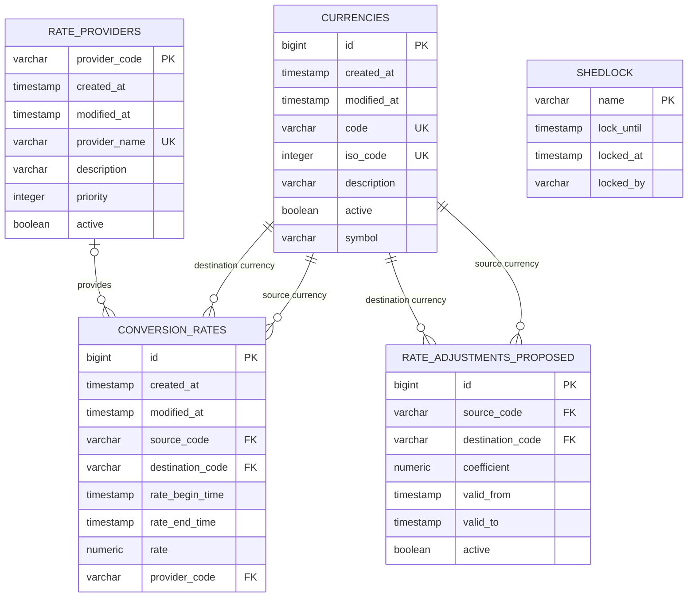
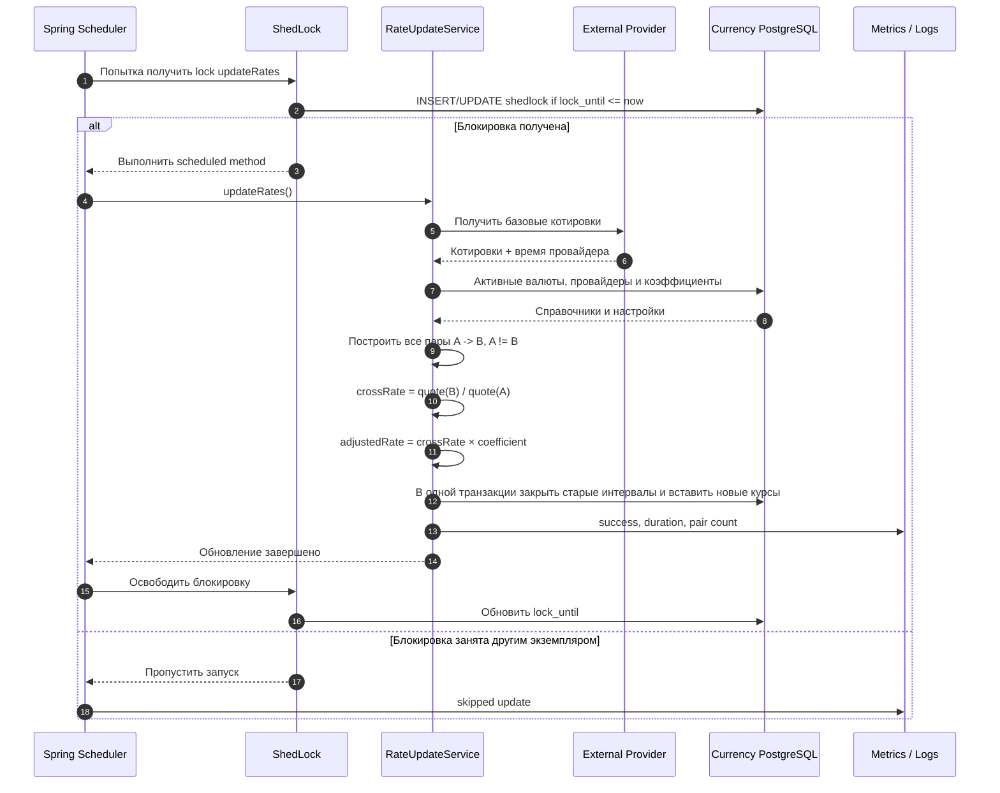
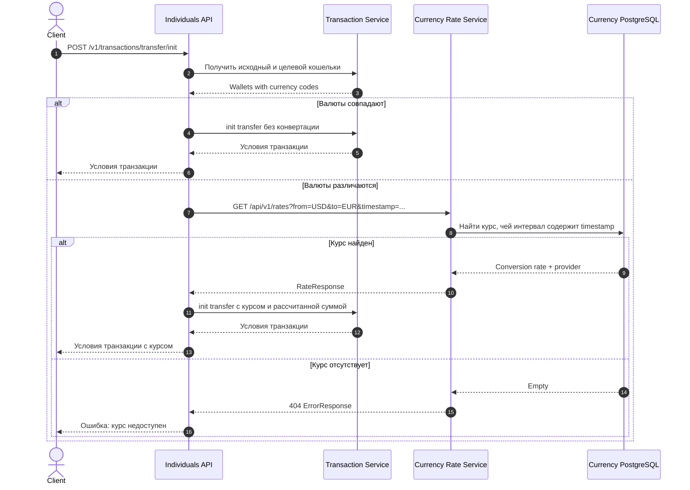

# Currency Rate Service architecture

Диаграммы микросервиса для получения, хранения и предоставления курсов валют по запросу других сервисов.

## Container diagram

Currency Rate Service владеет отдельной базой данных. Базы/шарды Transaction Service на
диаграмме не показаны, потому что новый сервис не должен обращаться к ним напрямую.

## Component diagram

Контроллер не содержит расчётной логики. Планировщик отвечает только за запуск сценария,
а блокировка ShedLock хранится в той же PostgreSQL, что и данные сервиса.

## Data model

`RATE_ADJUSTMENTS_PROPOSED` — необходимое расширение: т.к. требуется брать коэффициент
из таблицы, но такой таблицы в DDL нет. `SHEDLOCK` технически не связан
внешними ключами с бизнес-таблицами.

Для быстрого поиска курса потребуется составной индекс как минимум по
`(source_code, destination_code, rate_begin_time, rate_end_time)`.

## Scheduled rate update

При ошибке провайдера существующие актуальные курсы остаются неизменными, ошибка
логируется, а метрика неуспешного обновления увеличивается.

## Cross-currency transfer initialization

Курс, его timestamp/идентификатор и рассчитанные суммы
должны фиксироваться в условиях транзакции и повторно использоваться на `confirm`, а не
запрашиваться заново.

## Некоторые детали

1. В текущем контракте Transaction Service у `TransactionRequest` нет полей для курса,
   валюты назначения и рассчитанной суммы. Надо поменять контракт.
2. В DDL отсутствует таблица корректирующих коэффициентов; на ER-диаграмме показан
   минимальный вариант.