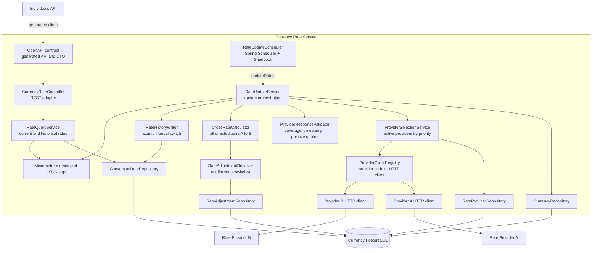

# Currency Rate Service - component diagram

Компоненты разделяют входные REST-запросы, выбор провайдера, проверку котировок, расчёт
курсов и ведение истории.

## Ответственность компонентов

- `CurrencyRateController` преобразует REST-запрос в вызов use case и не содержит
  расчётной логики.
- `RateQueryService` возвращает текущий курс, либо курс, действовавший в указанный момент.
- `RateUpdateScheduler` только инициирует обновление. Межэкземплярную блокировку выполняет
  ShedLock через таблицу в Currency PostgreSQL.
- `ProviderSelectionService` получает активных провайдеров в порядке `priority ASC`:
  меньшее число означает более высокий приоритет.
- `ProviderClientRegistry` выбирает HTTP-клиент по `provider_code`. Это позволяет иметь
  разные форматы запросов и ответов у поставщиков.
- `ProviderResponseValidator` не допускает расчёт по частичному, устаревшему или
  некорректному снимку котировок.
- `CrossRateCalculator` строит `N × (N − 1)` направленных пар в памяти.
- `RateAdjustmentResolver` выбирает коэффициент для направленной пары в момент
  `switchAt`. При отсутствии настройки используется коэффициент `1`.
- `RateHistoryWriter` одной транзакцией закрывает прежние интервалы и вставляет полный
  новый набор курсов. До этого шага таблица курсов не изменяется.

Формирование и проверка защищённого `quoteToken` относится к Transaction Service: 
он применяет курс при переводе и фиксирует финансовую операцию. Currency Rate Service
возвращает идентификатор неизменяемой записи курса и её параметры, но не токен
для клиента.
