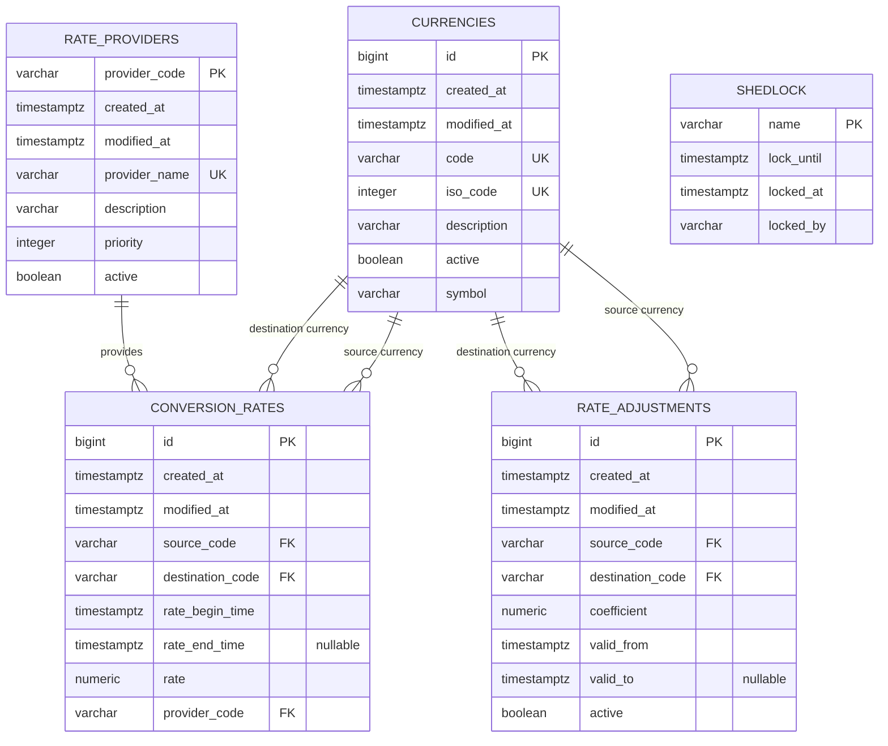

# Currency Rate Service - data model

Модель хранит справочники валют и провайдеров, историю рассчитанных курсов,
корректирующие коэффициенты и блокировку ShedLock.



`SHEDLOCK` не связан внешними ключами с бизнес-таблицами. Это техническая таблица,
используемая только для координации экземпляров планировщика.

## Интервалы действия курса

Все временные значения хранятся в UTC как `timestamptz`. Курс действует на полуоткрытом
интервале:

```text
[rate_begin_time, rate_end_time)
```

`rate_end_time = NULL` означает открытый интервал и текущий курс. Поэтому исходное
ограничение `rate_end_time NOT NULL` должно быть удалено миграцией.

Для выбранного момента `T` исторический курс удовлетворяет условию:

```sql
rate_begin_time <= T
AND (rate_end_time IS NULL OR T < rate_end_time)
```

Если параметр `timestamp` отсутствует, выбирается запись с `rate_end_time IS NULL`.
На границе переключения `T` предыдущий курс получает `rate_end_time = T`, а новый -
`rate_begin_time = T`. Одновременно подходящей может быть только новая запись.

`switchAt` равен timestamp полного снимка, полученного от выбранного провайдера. Снимок
принимается только если его timestamp свежее `rate_begin_time` текущего набора.
`created_at` отражает время сохранения и не используется как начало действия курса.

## Ограничения целостности курсов

- `source_code <> destination_code`;
- `rate > 0`;
- для каждой направленной пары существует не более одного открытого интервала;
- интервалы одной направленной пары не пересекаются;
- новый набор содержит ровно `N × (N − 1)` записей для `N` активных валют;
- старые интервалы закрываются и полный новый набор вставляется одной транзакцией;
- `provider_code` фиксирует провайдера исходного снимка, из которого рассчитан курс.

Для быстрого чтения нужны:

- частичный уникальный индекс по `(source_code, destination_code)` для строк с
  `rate_end_time IS NULL`;
- индекс исторического поиска по
  `(source_code, destination_code, rate_begin_time, rate_end_time)`;
- PostgreSQL exclusion constraint по направленной паре и временному диапазону для запрета
  пересечений.

## Корректирующие коэффициенты

Коэффициент задаётся для направленной пары: настройка `USD -> EUR` не применяется к
`EUR -> USD`. Он действует на полуоткрытом интервале `[valid_from, valid_to)`, где
`valid_to = NULL` означает открытый интервал.

При расчёте набора на момент `switchAt` выбирается активная запись, для которой:

```sql
valid_from <= switchAt
AND (valid_to IS NULL OR switchAt < valid_to)
```

Правила:

- `source_code <> destination_code`;
- `coefficient > 0`;
- интервалы одной направленной пары не могут пересекаться;
- отсутствие подходящей настройки означает коэффициент `1`;
- несколько найденных настроек считаются ошибкой конфигурации и полностью отменяют
  обновление курсов.

Итоговый курс рассчитывается как:

```text
crossRate(A -> B) = quote(B) / quote(A)
adjustedRate(A -> B) = crossRate(A -> B) × coefficient(A -> B, switchAt)
```

Округление выполняется один раз после применения коэффициента с едиными для сервиса
`scale` и `RoundingMode`, которые должны быть заданы конфигурацией.

## Выбор провайдера

Активные провайдеры сортируются по `priority ASC`: меньшее значение означает более
высокий приоритет. Желательно запретить одинаковый `priority` среди активных провайдеров
частичным уникальным индексом. При транспортной ошибке или невалидном снимке сервис
переходит к следующему провайдеру. Если список пуст или ни один провайдер не вернул
полный корректный снимок, таблица `conversion_rates` не изменяется.
