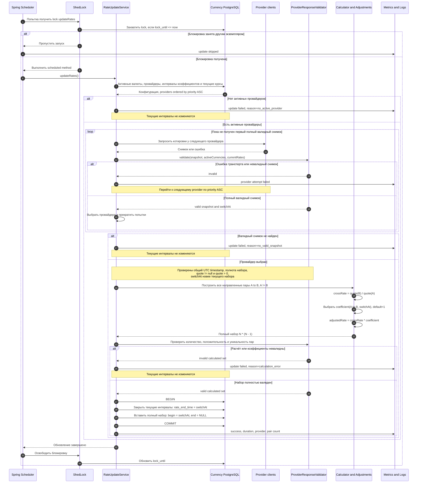
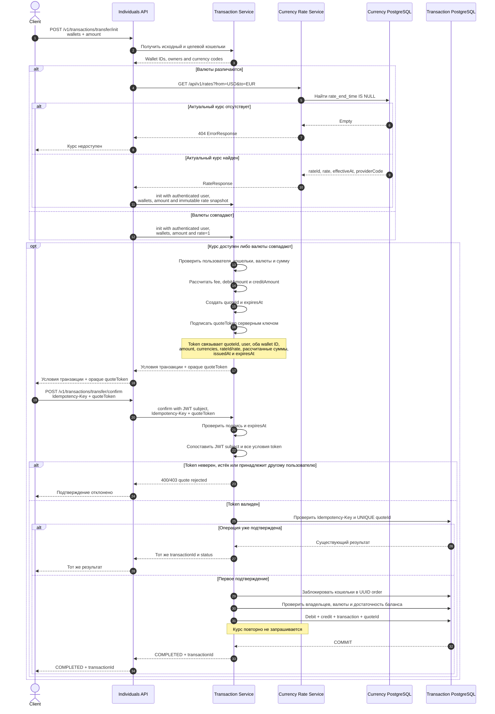

# Currency Rate Service - sequence diagrams

## Плановое обновление курсов

HTTP 200 от провайдера по идее не означает успешное обновление. До изменения истории
должны успешно завершиться проверка входного снимка, расчёт всех пар и применение всех
коэффициентов. Любая ошибка оставляет прежний набор актуальным.

## Межвалютный перевод: init и confirm

`quoteToken` - непрозрачное для клиента подписанное значение, например JWS.
Transaction Service создаёт и проверяет его одним серверным ключом. Клиент не передаёт на
`confirm` курс или рассчитанную сумму отдельными доверенными полями.

`quoteId` сохраняется при первом успешном `confirm` и имеет уникальное ограничение. Поэтому
один quote нельзя применить повторно с другим `Idempotency-Key`; повтор исходного запроса
возвращает уже созданную транзакцию.

## Контрактные изменения для перевода

Целевая версия контракта должна:

- дополнить `RateResponse` полями `rateId` и точным временем начала действия;
- позволить Individuals API передать в `init` неизменяемый снимок курса во внутренний
  контракт Transaction Service;
- вернуть из `init` `quoteToken` и `expiresAt`;
- принимать на `confirm` `quoteToken`, не доверяя присланным клиентом финансовым расчётам;
- возвращать отдельные ошибки для неверного и просроченного quote.