# Payment System - container diagram

Диаграмма показывает целевую архитектуру всей системы после добавления Currency Rate
Service. Внешний клиент обращается только к Individuals API. Остальные прикладные сервисы
доступны внутри сети приложения.

```mermaid
flowchart TB
    Client([Внешний клиент])
    PaymentProvider[Внешний платёжный провайдер]
    RateProvider[Внешний провайдер курсов]

    subgraph PaymentSystem[Payment System]
        subgraph EntryAndIdentity[Вход и управление пользователями]
            Individuals[Individuals API<br/>Spring Boot, :8081]
            Keycloak[Keycloak<br/>OAuth 2.0 / OIDC, :8080]
            KeycloakDb[(Keycloak PostgreSQL)]
            Person[Person Service<br/>Spring Boot, :8082]
            PersonDb[(Person PostgreSQL)]
        end

        subgraph Payments[Платежи и кошельки]
            Transaction[Transaction Service<br/>Spring Boot, :8084]
            Sharding[ShardingSphere JDBC]
            TransactionDb0[(Transaction PostgreSQL<br/>shard 0)]
            TransactionDb1[(Transaction PostgreSQL<br/>shard 1)]
            Kafka[(Kafka)]
        end

        subgraph Rates[Курсы валют]
            Currency[Currency Rate Service<br/>Spring Boot, :8083 internal]
            CurrencyDb[(Currency PostgreSQL<br/>курсы, настройки, ShedLock)]
        end

        subgraph Observability[Observability]
            Prometheus[Prometheus]
            Loki[Loki]
            Tempo[Tempo]
            Grafana[Grafana]
        end

        subgraph BuildInfrastructure[Build infrastructure]
            Nexus[Nexus Repository]
        end
    end

    Client -->|REST + Bearer JWT| Individuals

    Individuals -->|OIDC и Admin API| Keycloak
    Keycloak -->|JDBC| KeycloakDb
    Individuals -->|OpenAPI-generated client| Person
    Person -->|Spring Data JPA| PersonDb

    Individuals -->|OpenAPI-generated client<br/>кошельки и транзакции| Transaction
    Transaction --> Sharding
    Sharding --> TransactionDb0
    Sharding --> TransactionDb1
    Transaction -->|команды через outbox| Kafka
    Kafka -->|платёжные команды| PaymentProvider
    PaymentProvider -->|результаты операций| Kafka
    Kafka -->|результаты операций| Transaction

    Individuals -->|OpenAPI-generated client<br/>GET /api/v1/rates| Currency
    Currency -->|Spring Data JPA| CurrencyDb
    Currency -->|REST/HTTPS| RateProvider

    Prometheus -.->|scrape /actuator/prometheus| Individuals
    Prometheus -.->|scrape /actuator/prometheus| Person
    Prometheus -.->|scrape /api/v1/actuator/prometheus| Transaction
    Prometheus -.->|scrape /actuator/prometheus| Currency

    Individuals -.->|JSON logs| Loki
    Person -.->|JSON logs| Loki
    Transaction -.->|JSON logs| Loki
    Currency -.->|JSON logs| Loki

    Individuals -.->|OTLP traces| Tempo
    Person -.->|OTLP traces| Tempo
    Transaction -.->|OTLP traces| Tempo
    Currency -.->|OTLP traces| Tempo

    Grafana -->|metrics datasource| Prometheus
    Grafana -->|logs datasource| Loki
    Grafana -->|traces datasource| Tempo
```

## Границы и правила взаимодействия

- Individuals API - единственная внешняя точка входа для пользовательских запросов.
- Person, Transaction и Currency Rate Service не публикуют бизнес-API наружу.
- Каждый сервис владеет своим хранилищем и не читает таблицы другого сервиса.
- Transaction Service получает результаты платёжного провайдера через Kafka.
- Currency Rate Service самостоятельно обращается к внешним источникам котировок, но его
  REST API вызывается только Individuals API.
- Prometheus забирает метрики из сервисов; приложения не отправляют метрики в Prometheus.
- Приложения отправляют JSON-логи в Loki и трассировки по OTLP в Tempo. Grafana читает все
  три источника observability.
- Nexus относится к инфраструктуре сборки и распространения клиентских артефактов. Он не
  участвует в обработке пользовательских запросов.

На диаграмме указаны внутренние порты контейнеров.
