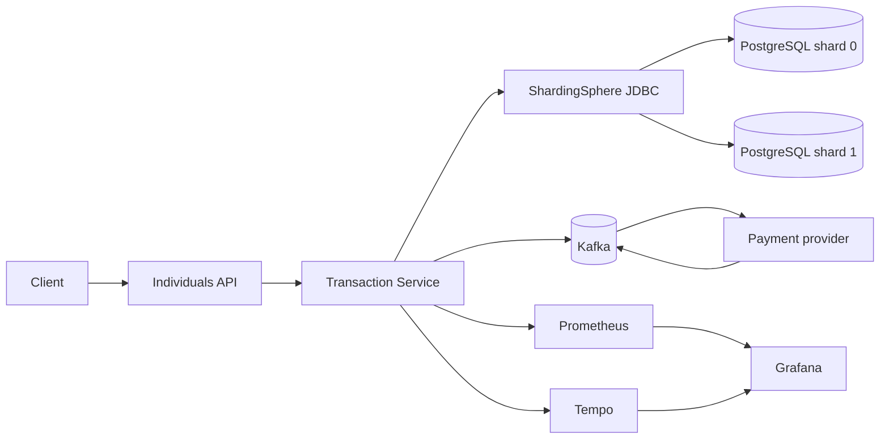
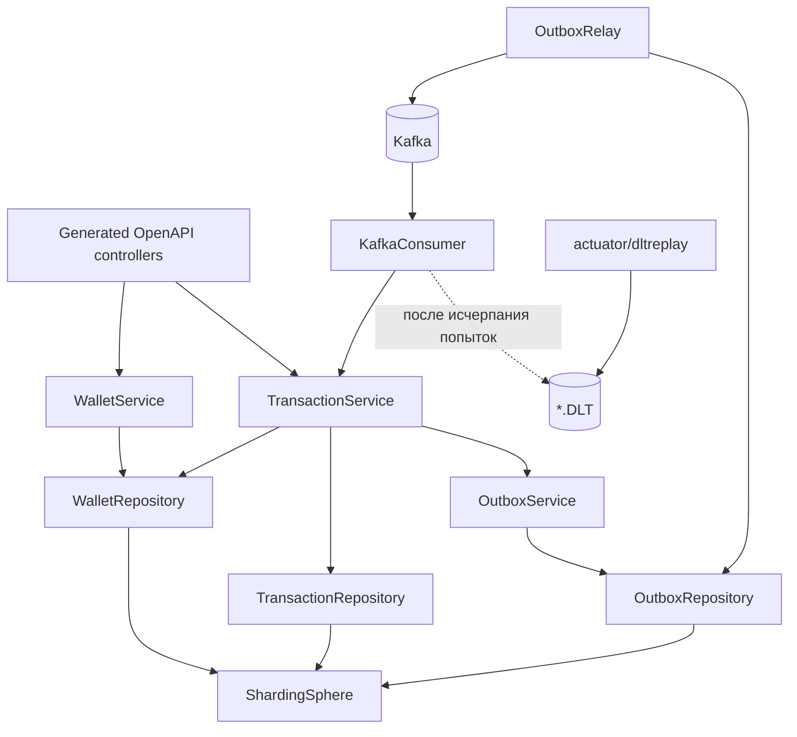
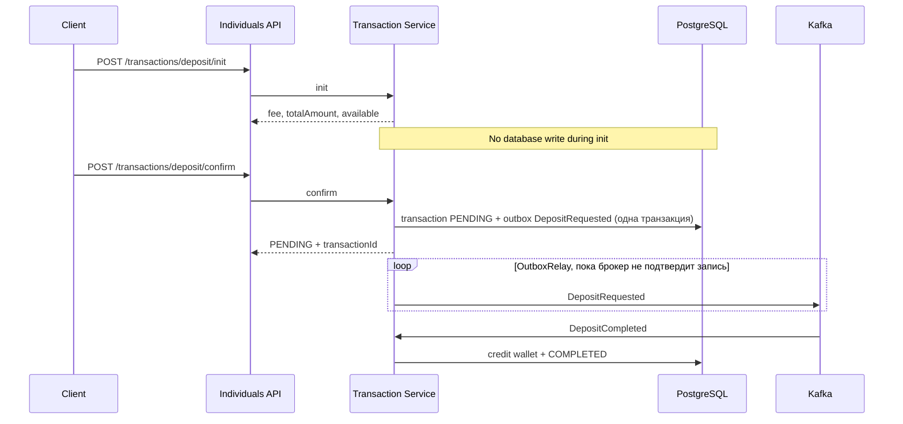
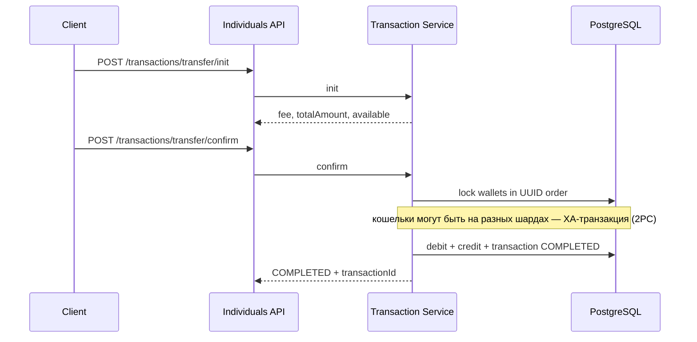
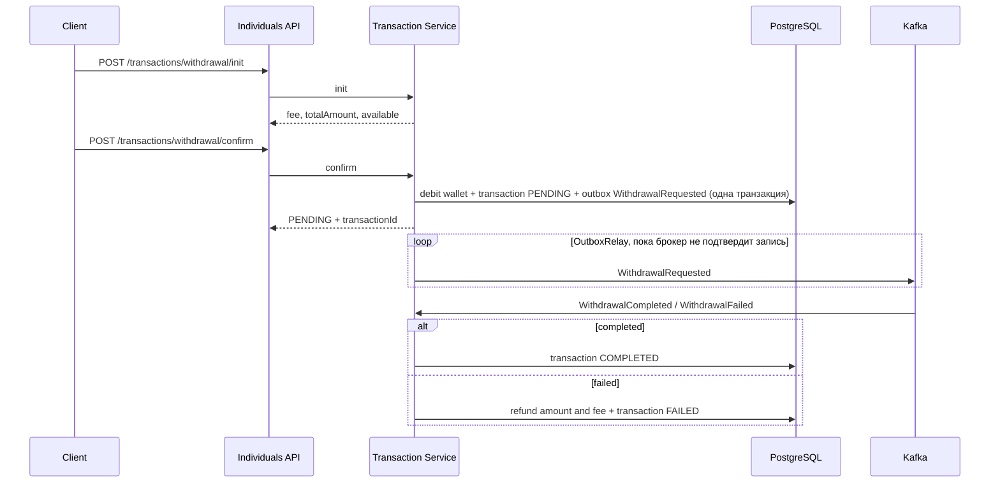

# Transaction Service architecture

## Container diagram

## Component diagram

Individuals API проверяет, что `userUid` запроса совпадает с `sub` Bearer-токена, и вызывает
Transaction Service сгенерированным Feign-клиентом.

## Deposit

## Transfer

## Withdrawal

## Обработка ответов провайдера

- Временная ошибка БД — повторы без ограничения числа попыток с паузой до `transaction.kafka.retry.max-interval`;
  следующие сообщения партиции ждут, offset не сдвигается.
- Невалидное сообщение — сразу в `<topic>.DLT`.
- Прочие ошибки — `transaction.kafka.retry.attempts` повторов, затем в `<topic>.DLT`.
- `POST /api/v1/actuator/dltreplay` переотправляет накопившиеся в DLT сообщения в исходные топики;
  финализация идемпотентна, поэтому повторная доставка безопасна.
